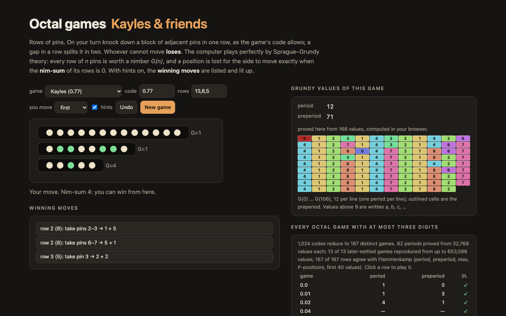

# Octal games — Kayles against a perfect player, and the period of every three-digit octal game



**Kayles**, **Dawson's Kayles** and any other **octal game** in the browser, against a perfect player. The board is
rows of pins; a move knocks down a block of adjacent pins in one row (how many, and whether the row may vanish, stay
in one piece or break in two, is set by the game's code). Whoever cannot move loses. With hints on, the winning moves
are listed and lit up.

Behind it is a recomputation of Achim Flammenkamp's tables of
[Sprague-Grundy values of octal games](http://wwwhomes.uni-bielefeld.de/achim/octal.html): the Grundy values of all
167 distinct games with at most three digits, their periods proved with the Guy–Smith periodicity theorem, and the
compendium that maps all 1,024 codes onto those 167 games.

TypeScript, no runtime dependencies.

## The code

An octal game is written d₀.d₁d₂d₃… Digit dₖ says what may remain after taking *k* pins from one row: add **1** if
the row may vanish, **2** if one row may remain, **4** if two rows may remain. Kayles is **0.77** (take one or two
adjacent pins anywhere), Dawson's Kayles **0.07** (always exactly two). A leading 4 lets a move cut a row in two
without taking anything (on the board, click the dashed gap between two pins).

## The perfect player

[`src/octal.ts`](src/octal.ts). By the Sprague–Grundy theorem every row of *n* pins is equivalent to a Nim heap of
size G(n), where G(n) is the smallest non-negative integer that is not the value of an option: G(a) for a move that
leaves one row of *a*, G(a) XOR G(b) for a move that leaves two rows. A position is lost for the side to move
exactly when the XOR (nim-sum) of its rows' values is 0, and the winning moves are the ones that make it 0. The
tests check this against a plain game-tree search on every position of up to three rows of up to 7 pins in five
games.

## Periods, and how they are proved

Every octal game with finitely many digits that has been settled is eventually periodic: G(n + p) = G(n) for all
n ≥ v. A finite computation proves it. If G(n + p) = G(n) holds for max(v,1) ≤ n < 2·max(v,1) + p + t, where *t* is
the number of digits, it holds for all n ≥ v — every option of a row of n + p pins has a part of at least
max(v,1) + p pins, which the period already covers. So `provePeriod` looks for the smallest p whose preperiod v
satisfies 2·max(v,1) + 2p + t ≤ (number of values computed). Kayles (p = 12, v = 71) needs 168 values.

## What came out

`npm run literature` downloads Flammenkamp's listings and keeps the facts in
[`src/literature.json`](src/literature.json). `npm run table` computes 32,768 values of each of the 167 standard
forms (one process per game, in parallel), runs the games that his page lists as solved later ("known structure")
with exactly as many values as the theorem needs, and folds everything into [`src/results.json`](src/results.json).
Node 26 on a 12-core Mac mini:

| | |
|---|---|
| standard forms | **167 of 167** agree with Flammenkamp: period, preperiod, largest value, number of P-positions and the first 40 values for the 74 he lists as periodic; the first 40 values for the other 93 |
| periods proved from 32,768 values | **82** — the 74, plus 8 that his short listing leaves blank because v + p > 250: 0.45, 0.055, 0.156, 0.165, 0.356, 0.644, 4.344, 4.364 |
| "known structure" games | 20 listed; the 13 whose period needs at most 653,570 values were run, and all 13 reproduce the published period and preperiod (table below) |
| compendium | **1,016 of 1,024** codes equal the game the compendium maps them to, up to an index shift; the other 8 agree with one of the 167 only after their first 1–5 values, and 5 of those the compendium lists as standard forms of their own although they are not among the 167 |

| game | period | preperiod | values needed | seconds |
|---|---:|---:|---:|---:|
| 0.45 | 20 | 498 | 1,038 | 0.01 |
| 0.055 | 148 | 259 | 817 | 0.01 |
| 4.344 | 51 | 998 | 2,101 | 0.03 |
| 0.644 | 442 | 3,256 | 7,399 | 0.15 |
| 0.156 | 349 | 3,479 | 7,659 | 0.12 |
| 0.165 | 1,550 | 5,181 | 13,465 | 0.32 |
| 0.356 | 142 | 7,315 | 14,917 | 0.42 |
| 4.364 | 62 | 11,687 | 23,501 | 1.71 |
| 0.127 | 4 | 46,578 | 93,167 | 8.08 |
| 4.064 | 16,132 | 94,272 | 220,811 | 158.06 |
| 0.16 | 149,459 | 105,351 | 509,622 | 254.87 |
| 4.406 | 44 | 294,097 | 588,285 | 895.33 |
| 0.56 | 144 | 326,640 | 653,570 | 751.64 |

The other seven (0.376, 0.354, 0.054, 0.104, 0.454, 0.106, 4.404) have preperiods from 2.3 million to 465 billion;
the plain O(n²) computation here does not reach them.

## Run it

```sh
npm install
npm run dev        # the page
npm test           # 12 tests
npm run literature # re-download Flammenkamp's tables into data/ and rebuild src/literature.json
npm run table      # recompute runs/*.jsonl and src/results.json (about 15 minutes on 6 cores)
```

## License

MIT. The numbers in `src/literature.json` are taken from Achim Flammenkamp's pages, which are the reference this
project checks itself against.
